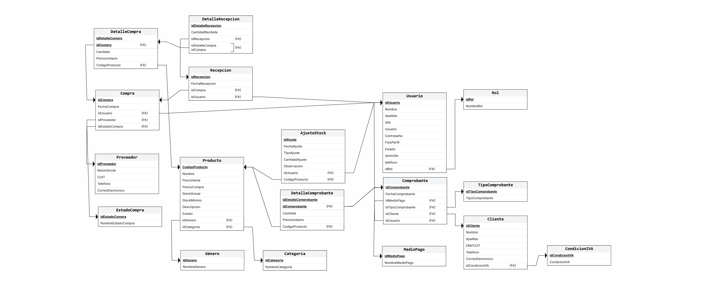

# Modelo Relacional

## 1. Introducción

El presente modelo relacional representa la estructura lógica de datos para el Sistema de Gestión Comercial, Control de Inventario y Facturación de **Joyería ALBA**.

Surge de la evolución del diseño conceptual inicial hacia un modelo transaccional completo compuesto por **18 relaciones**, organizadas en torno a cuatro circuitos operativos fundamentales:
1. **Administración de accesos y seguridad:** `Rol` y `Usuario`.
2. **Catálogo de productos e inventario:** `Categoria`, `Genero`, `Producto` y `AjusteStock`.
3. **Circuito de abastecimiento (Compras):** `Proveedor`, `EstadoCompra`, `MedioPago`, `Compra`, `DetalleCompra`, `Recepcion` y `DetalleRecepcion`.
4. **Circuito de ventas y facturación:** `CondicionIVA`, `Cliente`, `TipoComprobante`, `Comprobante` y `DetalleComprobante`.

### Referencias utilizadas
* **PK:** Clave primaria (*Primary Key*).
* **FK:** Clave foránea (*Foreign Key*).
* **UK:** Clave única (*Unique Key*).
* **NULL:** Atributo opcional.
* **NOT NULL:** Atributo obligatorio.

---

## 2. Relaciones Resultantes por Módulo

### Módulo A: Accesos y Seguridad

#### ROL
```text
Rol(
    IdRol PK,
    NombreRol UK NOT NULL
)
```
Almacena los perfiles de usuario del sistema (ej. Administrador, Vendedor, Encargado de inventario, Cliente).

#### USUARIO
```text
Usuario(
    IdUsuario PK,
    Nombre NOT NULL,
    Apellido NOT NULL,
    DNI UK NOT NULL,
    NombreUsuario UK NOT NULL,
    Contrasenia NOT NULL,
    Email UK NOT NULL,
    Estado NOT NULL,
    Domicilio NULL,
    Telefono NULL,
    IdRol FK NOT NULL
)
```
* **Clave foránea:** `IdRol` referencia a `Rol(IdRol)`.
* Representa al personal y usuarios registrados de la joyería. El atributo `Estado` permite aplicar baja lógica (`'Activo'`, `'Inactivo'`).

---

### Módulo B: Catálogo de Joyas e Inventario

#### CATEGORIA
```text
Categoria(
    idCategoria PK,
    NombreCategoria UK NOT NULL
)
```
Clasifica las piezas de joyería (ej. Anillos, Cadenas, Pulseras, Relojes).

#### GENERO
```text
Genero(
    idGenero PK,
    NombreGenero UK NOT NULL
)
```
Clasifica las joyas según el público destinatario (ej. Dama, Caballero, Unisex).

#### PRODUCTO
```text
Producto(
    CodigoProducto PK,
    Nombre NOT NULL,
    PrecioVenta NOT NULL,
    PrecioCompra NOT NULL,
    StockActual NOT NULL,
    StockMinimo NOT NULL,
    Descripcion NULL,
    Estado NOT NULL,
    idGenero FK NOT NULL,
    idCategoria FK NOT NULL
)
```
* **Claves foráneas:**
  * `idGenero` referencia a `Genero(idGenero)`.
  * `idCategoria` referencia a `Categoria(idCategoria)`.
* Representa el catálogo físico de joyas. Contiene precios vigentes y existencias de stock. El campo `Estado` implementa la baja lógica (`'ACTIVO'`, `'INACTIVO'`).

#### AJUSTESTOCK
```text
AjusteStock(
    idAjuste PK,
    FechaAjuste NOT NULL,
    TipoAjuste NOT NULL,
    CantidadAjuste NOT NULL,
    Observacion NULL,
    idUsuario FK NOT NULL,
    CodigoProducto FK NOT NULL
)
```
* **Claves foráneas:**
  * `idUsuario` referencia a `Usuario(IdUsuario)`.
  * `CodigoProducto` referencia a `Producto(CodigoProducto)`.
* Registra movimientos extraordinarios de inventario (mermas, roturas en vitrina, sobrantes o faltantes de inventario físico), auditando al usuario responsable.

---

### Módulo C: Abastecimiento y Compras a Proveedores

#### PROVEEDOR
```text
Proveedor(
    IdProveedor PK,
    RazonSocial NOT NULL,
    CUIT UK NOT NULL,
    Telefono NOT NULL,
    CorreoElectronico NULL
)
```
Almacena a los fabricantes y distribuidores mayoristas de metales y piedras preciosas.

#### ESTADOCOMPRA
```text
EstadoCompra(
    IdEstadoCompra PK,
    NombreEstadoCompra NOT NULL
)
```
Catálogo con los estados del pedido de compra (ej. Pendiente, Aprobada, Recibida Conforme, Cancelada).

#### MEDIOPAGO
```text
MedioPago(
    IdMedioPago PK,
    NombreMedioPago NOT NULL
)
```
Medios de pago admitidos para transacciones comerciales (Efectivo, Transferencia, Tarjeta de Débito, Tarjeta de Crédito).

#### COMPRA
```text
Compra(
    IdCompra PK,
    FechaCompra NOT NULL,
    IdUsuario FK NOT NULL,
    IdProveedor FK NOT NULL,
    IdEstadoCompra FK NOT NULL,
    IdMedioPago FK NOT NULL
)
```
* **Claves foráneas:**
  * `IdUsuario` referencia a `Usuario(IdUsuario)`.
  * `IdProveedor` referencia a `Proveedor(IdProveedor)`.
  * `IdEstadoCompra` referencia a `EstadoCompra(IdEstadoCompra)`.
  * `IdMedioPago` referencia a `MedioPago(IdMedioPago)`.
* Cabecera de la orden de compra emitida a un proveedor mayorista.

#### DETALLECOMPRA
```text
DetalleCompra(
    IdDetalleCompra PK,
    IdCompra FK NOT NULL,
    Cantidad NOT NULL,
    PrecioUnitario NOT NULL,
    IdProducto FK NOT NULL
)
```
* **Claves foráneas:**
  * `IdCompra` referencia a `Compra(IdCompra)`.
  * `IdProducto` referencia a `Producto(CodigoProducto)`.
* Renglones de la orden de compra. Preserva el `PrecioUnitario` pactado al momento de emitir la compra.

#### RECEPCION
```text
Recepcion(
    idRecepcion PK,
    FechaRecepcion NOT NULL,
    idCompra FK NOT NULL,
    idUsuario FK NOT NULL
)
```
* **Claves foráneas:**
  * `idCompra` referencia a `Compra(IdCompra)`.
  * `idUsuario` referencia a `Usuario(IdUsuario)`.
* Registra el ingreso físico real de mercadería a depósito asociado a una orden de compra previa.

#### DETALLERECEPCION
```text
DetalleRecepcion(
    idDetalleRecepcion PK,
    CantidadRecibida NOT NULL,
    idRecepcion FK NOT NULL,
    idDetalleCompra FK NOT NULL
)
```
* **Claves foráneas:**
  * `idRecepcion` referencia a `Recepcion(idRecepcion)`.
  * `idDetalleCompra` referencia a `DetalleCompra(IdDetalleCompra)`.
* Detalla las unidades efectivamente recibidas por ítem, permitiendo controlar entregas parciales frente a lo comprado.

---

### Módulo D: Clientes, Ventas y Facturación

#### CONDICIONIVA
```text
CondicionIVA(
    idCondicionIVA PK,
    CondicionIVA UK NOT NULL
)
```
Tipos impositivos frente a AFIP/ARCA (ej. Responsable Inscripto, Monotributo, Consumidor Final, Exento).

#### CLIENTE
```text
Cliente(
    idCliente PK,
    Nombre NOT NULL,
    Apellido NOT NULL,
    DNI_CUIT UK NOT NULL,
    Telefono NULL,
    CorreoElectronico NULL,
    idCondicionIVA FK NOT NULL
)
```
* **Clave foránea:** `idCondicionIVA` referencia a `CondicionIVA(idCondicionIVA)`.
* Almacena los datos fiscales y de contacto de compradores recurrentes o empresas.

#### TIPOCOMPROBANTE
```text
TipoComprobante(
    idTipoComprobante PK,
    TipoComprobante UK NOT NULL
)
```
Clasificación legal del documento contable emitido (ej. Factura A, Factura B, Ticket Consumidor Final, Nota de Crédito).

#### COMPROBANTE
```text
Comprobante(
    idComprobante PK,
    FechaComprobante NOT NULL,
    idMedioPago FK NOT NULL,
    idTipoComprobante FK NOT NULL,
    idCliente FK NOT NULL,
    idUsuario FK NOT NULL
)
```
* **Claves foráneas:**
  * `idMedioPago` referencia a `MedioPago(IdMedioPago)`.
  * `idTipoComprobante` referencia a `TipoComprobante(idTipoComprobante)`.
  * `idCliente` referencia a `Cliente(idCliente)`.
  * `idUsuario` referencia a `Usuario(IdUsuario)`.
* Cabecera de la factura o ticket de venta emitido en mostrador. Asocia al cliente atendido, al vendedor responsable y la modalidad de cobro.

#### DETALLECOMPROBANTE
```text
DetalleComprobante(
    idDetalleComprobante PK,
    idComprobante FK NOT NULL,
    Cantidad NOT NULL,
    PrecioUnitario NOT NULL,
    CodigoProducto FK NOT NULL
)
```
* **Claves foráneas:**
  * `idComprobante` referencia a `Comprobante(idComprobante)`.
  * `CodigoProducto` referencia a `Producto(CodigoProducto)`.
* Renglones del comprobante de venta. Almacena el `PrecioUnitario` histórico de venta, protegiendo las cifras de facturación frente a posteriores aumentos de precio de la joya.

---

## 3. Resumen de Claves del Esquema

| Relación | Clave Primaria (PK) | Claves Foráneas (FK) | Claves Únicas (UK) |
|---|---|---|---|
| **Rol** | `IdRol` | — | `NombreRol` |
| **Usuario** | `IdUsuario` | `IdRol` | `DNI`, `NombreUsuario`, `Email` |
| **Categoria** | `idCategoria` | — | `NombreCategoria` |
| **Genero** | `idGenero` | — | `NombreGenero` |
| **Producto** | `CodigoProducto` | `idGenero`, `idCategoria` | — |
| **AjusteStock** | `idAjuste` | `idUsuario`, `CodigoProducto` | — |
| **Proveedor** | `IdProveedor` | — | `CUIT` |
| **EstadoCompra** | `IdEstadoCompra` | — | — |
| **MedioPago** | `IdMedioPago` | — | — |
| **Compra** | `IdCompra` | `IdUsuario`, `IdProveedor`, `IdEstadoCompra`, `IdMedioPago` | — |
| **DetalleCompra** | `IdDetalleCompra` | `IdCompra`, `IdProducto` | — |
| **Recepcion** | `idRecepcion` | `idCompra`, `idUsuario` | — |
| **DetalleRecepcion** | `idDetalleRecepcion` | `idRecepcion`, `idDetalleCompra` | — |
| **CondicionIVA** | `idCondicionIVA` | — | `CondicionIVA` |
| **Cliente** | `idCliente` | `idCondicionIVA` | `DNI_CUIT` |
| **TipoComprobante** | `idTipoComprobante` | — | `TipoComprobante` |
| **Comprobante** | `idComprobante` | `idMedioPago`, `idTipoComprobante`, `idCliente`, `idUsuario` | — |
| **DetalleComprobante** | `idDetalleComprobante` | `idComprobante`, `CodigoProducto` | — |

---

## 4. Reglas de Integridad Referencial Aplicadas

* **Integridad de Entidad:** Cada relación posee una clave primaria simple con numeración autoincremental (`IDENTITY`), garantizando unicidad y alto rendimiento en búsquedas e índices.
* **Integridad Referencial:** Todas las claves foráneas hacen referencia a claves primarias válidas en sus tablas de origen. Para resguardar el historial contable ante intentos accidentales de borrado, se aplica la directiva `ON DELETE NO ACTION`.
* **Integridad de Dominio (`CHECK`):**
  * `PrecioVenta > 0` y `PrecioCompra >= 0` en `Producto`.
  * `StockActual >= 0` y `StockMinimo >= 0` en `Producto`.
  * `Cantidad > 0` y `PrecioUnitario >= 0` en `DetalleComprobante` y `DetalleCompra`.
  * `CantidadRecibida >= 0` en `DetalleRecepcion`.
  * `CantidadAjuste <> 0` en `AjusteStock`.
  * Formato válido de correo electrónico en `Cliente` y `Usuario`.

---

## 5. Diagrama del Modelo Relacional



---

## 6. Conclusión

El esquema relacional resultante de 18 tablas proporciona una arquitectura robusta, normalizada y escalable para Joyería ALBA. Resuelve de manera eficiente la separación de flujos de compra y venta, asegura la trazabilidad estricta de existencias de joyas y mantiene la exactitud de los precios históricos frente a fluctuaciones de mercado.
