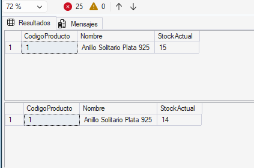
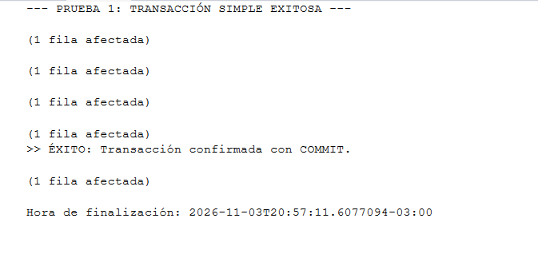
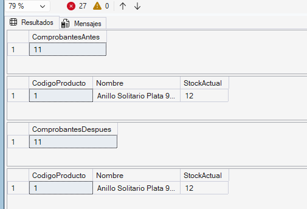
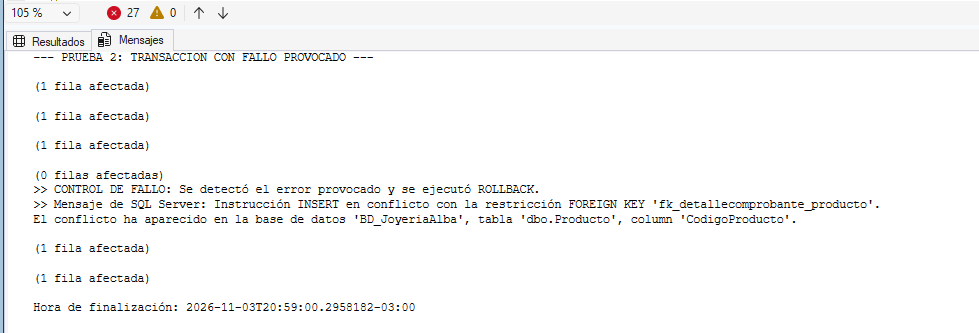
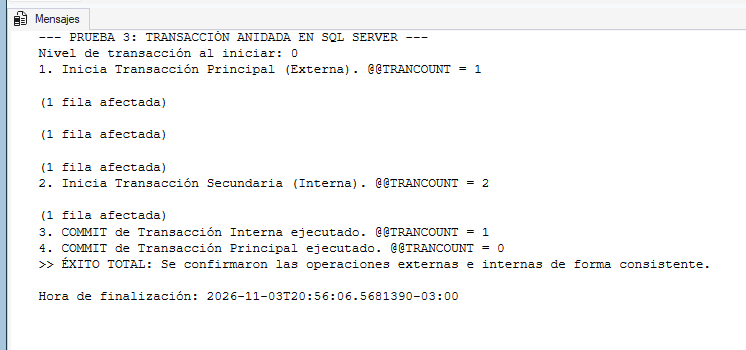

# Etapa V: Manejo de Transacciones y Transacciones Anidadas

## 1. ¿Qué es una transacción y para qué la usamos?

### Idea básica
En una base de datos relacional, una **transacción** es básicamente un grupo de órdenes SQL que tienen que funcionar juntas como si fueran una sola cosa. La regla principal es que **o se hace todo bien, o no se hace nada**.

Si estamos haciendo una operación de varios pasos y en el medio salta un error, el motor no puede dejar las cosas a medias: tiene que deshacer lo que llegó a tocar y dejar la base de datos exactamente igual a como estaba antes de arrancar.

### Conceptos clave que aplicamos:
* **Atomicidad (el "todo o nada"):** Si una venta requiere registrar tres cosas y la última falla, las dos anteriores se cancelan automáticamente.
* **Consistencia:** Sirve para que la base de datos nunca quede rota ni con datos raros, respetando siempre las reglas como las claves primarias (`PK`) o las claves foráneas (`FK`).

### Objetivo del trabajo
El objetivo de esta etapa es probar cómo manejar transacciones de forma manual usando código T-SQL en SQL Server Express. La idea es ver en la práctica cómo proteger operaciones complejas (donde insertamos registros y descontamos stock a la vez), tanto en transacciones comunes como anidadas (una adentro de otra), asegurando que si ocurre un problema el sistema no quede inconsistente.

---

## 2. ¿Por qué nos sirve esto en el sistema de la joyería?

En una joyería una venta nunca afecta a una sola tabla. Cuando un cliente compra algo pasan tres cosas obligatorias:
1. Se crea la cabecera de la factura en la tabla `Comprobante`.
2. Se cargan los renglones de lo que compró en la tabla `DetalleComprobante`.
3. Se resta del inventario la mercadería vendida en la tabla `Producto`.

### ¿Qué ventajas nos da aplicarlo acá?
* **Evita datos sueltos o a medias:** No puede pasar nunca que se emita una factura sin sus productos, o que se reste stock de una joya sin que quede registrada la venta en el sistema.
* **Seguridad ante cortes o errores:** Si se corta internet, se apaga la máquina o se tipea mal el código de un artículo, el sistema hace marcha atrás (`ROLLBACK`) y no deja basura guardada.
* **Orden en el negocio:** Nos permite conectar otros procesos (como registrar un movimiento en stock) sin riesgo de arruinar el comprobante principal.

---

## 3. Comandos que usamos en SQL Server

Para controlar las transacciones usamos estas instrucciones de T-SQL:
* **`BEGIN TRANSACTION`:** Le avisa al motor que acá empieza un bloque de trabajo protegido. Las modificaciones quedan como en borrador.
* **`COMMIT TRANSACTION`:** Confirma la operación y guarda los cambios de forma definitiva en la base de datos.
* **`ROLLBACK TRANSACTION`:** Cancela todo lo que se hizo desde el inicio de la transacción y vuelve las tablas para atrás.
* **Bloque `TRY...CATCH`:** Es la estructura para atrapar fallos. En el `TRY` ponemos las operaciones normales; si alguna línea da error, el programa salta directo al `CATCH` para no colgarse y ejecutar el `ROLLBACK`.
* **`@@TRANCOUNT`:** Es un contador que tiene SQL Server para saber cuántas transacciones tenemos abiertas al mismo tiempo. Cuando hacemos un `BEGIN TRAN` suma 1, con cada `COMMIT` resta 1, y si tiramos un `ROLLBACK` vuelve directamente a 0.

---

## 4. El caso práctico que elegimos

Para probar esto en nuestro sistema, simulamos la venta en el local de 1 unidad del artículo **Anillo Solitario Plata 925** (`CodigoProducto = 1`).

Para cumplir con la consigna de tocar al menos tres tablas encadenadas, la operación hace lo siguiente:
* **Paso 1 (`INSERT` en `Comprobante`):** Guardamos los datos de la factura (fecha, cliente, vendedor, medio de pago).
* **Paso 2 (`INSERT` en `DetalleComprobante`):** Guardamos el detalle con el producto vendido y el precio, enlazado al comprobante recién creado.
* **Paso 3 (`UPDATE` en `Producto`):** Le restamos 1 unidad al `StockActual` de ese anillo.

---

## 5. Pruebas realizadas y resultados

### Parte A: Transacciones Simples

#### 1. Caso de Éxito (Todo sale bien y confirmamos con COMMIT)
En esta primera prueba ejecutamos los tres pasos seguidos dentro del bloque protegido para verificar que todo se guarde correctamente.

```sql
USE BD_JoyeriaAlba;
GO

PRINT '--- PRUEBA 1: TRANSACCIÓN SIMPLE EXITOSA ---';

-- Miramos el stock antes de empezar
SELECT CodigoProducto, Nombre, StockActual 
FROM Producto 
WHERE CodigoProducto = 1;

BEGIN TRY
    BEGIN TRANSACTION;

    -- Paso 1: Crear la cabecera de la venta
    INSERT INTO Comprobante (FechaComprobante, idMedioPago, idTipoComprobante, idCliente, idUsuario)
    VALUES (GETDATE(), 1, 2, 1, 1);

    -- Guardamos el ID autoincremental que se acaba de generar
    DECLARE @idVenta INT = SCOPE_IDENTITY();

    -- Paso 2: Crear el detalle de la venta
    INSERT INTO DetalleComprobante (idComprobante, CodigoProducto, Cantidad, PrecioUnitario)
    VALUES (@idVenta, 1, 1, 45000.00);

    -- Paso 3: Descontar 1 unidad del inventario
    UPDATE Producto
    SET StockActual = StockActual - 1
    WHERE CodigoProducto = 1;

    -- Si no hubo ningún problema, guardamos todo
    COMMIT TRANSACTION;
    PRINT '>> ÉXITO: Transacción confirmada con COMMIT.';
END TRY
BEGIN CATCH
    -- Si algo falla, cancelamos los cambios
    IF @@TRANCOUNT > 0
        ROLLBACK TRANSACTION;

    PRINT '>> ERROR: Se canceló la transacción. Detalle: ' + ERROR_MESSAGE();
END CATCH;
GO

-- Miramos el stock final (debería tener 1 unidad menos)
SELECT CodigoProducto, Nombre, StockActual 
FROM Producto 
WHERE CodigoProducto = 1;
GO
```

**Lo que pasó en la prueba:**  
La consulta terminó bien y mostró el mensaje de éxito en la consola. Al revisar la tabla `Producto`, vimos que el stock pasó de 15 a 14 unidades de forma correcta. Además, comprobamos que tanto la factura como su detalle quedaron bien guardados y relacionados.

**Verificación del stock (bajó de 15 a 14):**  


**Mensaje de confirmación en la consola:**  


---

#### 2. Caso de Fallo Provocado (Probando el ROLLBACK)
Para cumplir con la consigna de forzar un error, metimos a propósito un producto que no existe (`CodigoProducto = 9999`) en el segundo paso. Como la base de datos tiene una clave foránea que controla que los productos existan, el motor tiene que frenar la ejecución.

```sql
USE BD_JoyeriaAlba;
GO

PRINT '--- PRUEBA 2: TRANSACCIÓN CON FALLO PROVOCADO ---';

-- Nos fijamos cuántos comprobantes hay y el stock actual antes de probar
SELECT COUNT(*) AS ComprobantesAntes FROM Comprobante;
SELECT CodigoProducto, Nombre, StockActual FROM Producto WHERE CodigoProducto = 1;

BEGIN TRY
    BEGIN TRANSACTION;

    -- Paso 1: Inserta bien la cabecera
    INSERT INTO Comprobante (FechaComprobante, idMedioPago, idTipoComprobante, idCliente, idUsuario)
    VALUES (GETDATE(), 1, 2, 1, 1);

    DECLARE @idVentaFallida INT = SCOPE_IDENTITY();

    -- Paso 2: ACÁ FORZAMOS EL ERROR
    -- El producto 9999 no existe en la base, así que rompe por clave foránea
    INSERT INTO DetalleComprobante (idComprobante, CodigoProducto, Cantidad, PrecioUnitario)
    VALUES (@idVentaFallida, 9999, 1, 45000.00);

    -- Paso 3: Restar stock (a esta línea el motor ni debería llegar)
    UPDATE Producto
    SET StockActual = StockActual - 1
    WHERE CodigoProducto = 1;

    COMMIT TRANSACTION;
    PRINT '>> ÉXITO: Transacción completada.';
END TRY
BEGIN CATCH
    -- El motor detecta el error y salta directamente acá
    IF @@TRANCOUNT > 0
        ROLLBACK TRANSACTION;

    PRINT '>> CONTROL DE FALLO: Se detectó el error provocado y se ejecutó ROLLBACK.';
    PRINT '>> Mensaje de SQL Server: ' + ERROR_MESSAGE();
END CATCH;
GO

-- Verificamos que nada haya cambiado
SELECT COUNT(*) AS ComprobantesDespues FROM Comprobante;
SELECT CodigoProducto, Nombre, StockActual FROM Producto WHERE CodigoProducto = 1;
GO
```

**Lo que pasó en la prueba:**  
Tal como esperábamos, SQL Server saltó al bloque `CATCH` por la violación de clave foránea e hizo el `ROLLBACK`.  
Al contar los comprobantes con `COUNT(*)`, la cantidad antes y después del fallo fue exactamente la misma (11 comprobantes). La cabecera que se había insertado en el primer paso se borró por completo y el stock siguió intacto en 12 unidades, demostrando que no quedó nada guardado a medias y que se mantuvo la consistencia.

**Comprobantes y stock sin modificaciones tras el fallo:**  


**Aviso de error capturado y ROLLBACK ejecutado:**  


---

### Parte B: Transacciones Anidadas

#### 1. ¿Cómo funcionan las transacciones anidadas y `@@TRANCOUNT`?
Una transacción anidada es cuando abrimos una transacción nueva adentro de otra que ya estaba abierta. SQL Server las administra mirando la variable interna `@@TRANCOUNT`:
* El primer `BEGIN TRANSACTION` sube el contador a 1.
* El segundo `BEGIN TRANSACTION` sube el contador a 2.
* Cuando hacemos `COMMIT` en la transacción interna, el contador baja a 1, pero **todavía no guarda los datos definitivamente en el disco**.
* Recién cuando se ejecuta el último `COMMIT` de afuera y el contador llega a 0, se confirman todos los cambios.
* Si en cualquier momento salta un `ROLLBACK`, el contador se va a 0 de golpe y se cancela absolutamente todo (tanto lo de afuera como lo de adentro).

#### 2. Código de prueba del circuito anidado
Acá armamos un caso donde la transacción principal hace la venta del anillo y una transacción secundaria guarda un movimiento en la tabla `AjusteStock`.

```sql
USE BD_JoyeriaAlba;
GO

PRINT '--- PRUEBA 3: TRANSACCIÓN ANIDADA EN SQL SERVER ---';
PRINT 'Nivel de transacción al iniciar: ' + CAST(@@TRANCOUNT AS VARCHAR);

BEGIN TRY
    -- Nivel 1: Venta principal (Externa)
    BEGIN TRANSACTION VentaPrincipal;
    PRINT '1. Inicia Transacción Principal (Externa). @@TRANCOUNT = ' + CAST(@@TRANCOUNT AS VARCHAR);

    INSERT INTO Comprobante (FechaComprobante, idMedioPago, idTipoComprobante, idCliente, idUsuario)
    VALUES (GETDATE(), 1, 2, 1, 1);

    DECLARE @idVentaAnidada INT = SCOPE_IDENTITY();

    INSERT INTO DetalleComprobante (idComprobante, CodigoProducto, Cantidad, PrecioUnitario)
    VALUES (@idVentaAnidada, 1, 1, 45000.00);

    UPDATE Producto
    SET StockActual = StockActual - 1
    WHERE CodigoProducto = 1;

    -- Nivel 2: Registro secundario (Interna)
    BEGIN TRANSACTION LogisticaInterna;
    PRINT '2. Inicia Transacción Secundaria (Interna). @@TRANCOUNT = ' + CAST(@@TRANCOUNT AS VARCHAR);

    -- Guardamos un movimiento de ajuste por la salida del mostrador
    INSERT INTO AjusteStock (FechaAjuste, CantidadAjuste, TipoAjuste, Observacion, CodigoProducto, idUsuario)
    VALUES (GETDATE(), -1, 'Venta Mostrador', 'Salida automática vinculada a venta', 1, 1);

    -- Este COMMIT solo resta 1 al contador, no guarda en disco todavía
    COMMIT TRANSACTION LogisticaInterna;
    PRINT '3. COMMIT de Transacción Interna ejecutado. @@TRANCOUNT = ' + CAST(@@TRANCOUNT AS VARCHAR);

    -- Con este COMMIT el contador llega a 0 y se confirma todo junto
    COMMIT TRANSACTION VentaPrincipal;
    PRINT '4. COMMIT de Transacción Principal ejecutado. @@TRANCOUNT = ' + CAST(@@TRANCOUNT AS VARCHAR);

    PRINT '>> ÉXITO TOTAL: Se confirmaron las operaciones externas e internas de forma consistente.';
END TRY
BEGIN CATCH
    -- Si algo falla en cualquier nivel, se cancela todo
    IF @@TRANCOUNT > 0
    BEGIN
        ROLLBACK TRANSACTION;
        PRINT '>> ERROR DETECTADO: Se ejecutó ROLLBACK completo. @@TRANCOUNT se restableció a: ' + CAST(@@TRANCOUNT AS VARCHAR);
        PRINT '>> Detalle: ' + ERROR_MESSAGE();
    END
END CATCH;
GO
```

**Lo que pasó en la prueba:**  
En la consola de mensajes pudimos ver paso a paso cómo funcionó el contador: empezó en 0, subió a 1, pasó a 2 en la transacción interna, bajó a 1 con el primer commit y finalmente quedó en 0 con el commit principal, guardando todas las filas de una sola vez.

**Seguimiento del contador @@TRANCOUNT en los mensajes:**  


---

## 6. Conclusiones de las pruebas

1. **Comprobamos la regla de "todo o nada":** Cuando forzamos el error con un producto inexistente, la base de datos no guardó cosas incompletas. La orden `ROLLBACK` canceló el comprobante que ya se había creado, demostrando que la transacción funciona en bloque.
2. **Importancia del TRY...CATCH:** Nos sirvió para interceptar los errores de forma prolija. Gracias a esto, si algo sale mal durante una venta, el programa no se rompe y se asegura de cerrar la transacción para no dejar tablas bloqueadas en el servidor.
3. **Cómo maneja SQL Server las transacciones anidadas:** Vimos que en SQL Server no existen confirmaciones por partes. Los `COMMIT` de adentro solo bajan el contador; los datos realmente se guardan cuando termina la transacción principal de afuera. Y si algo falla en el medio, un solo `ROLLBACK` cancela todo el paquete completo.
