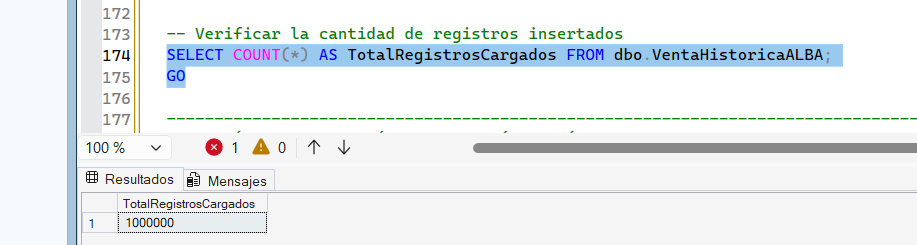
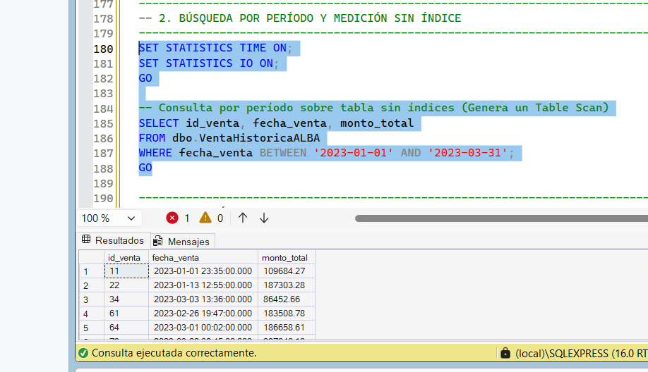
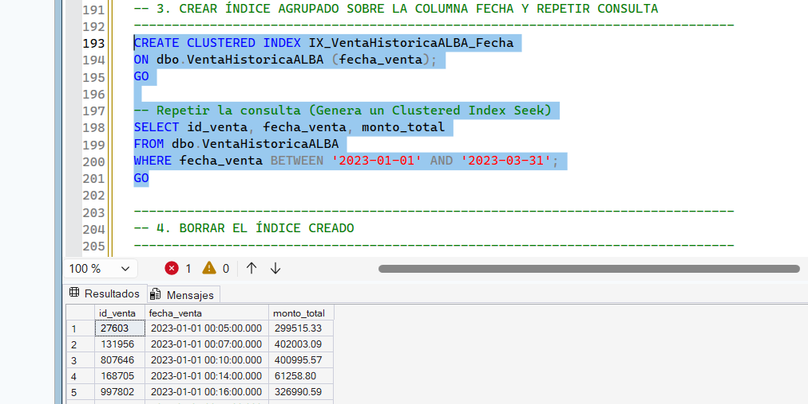
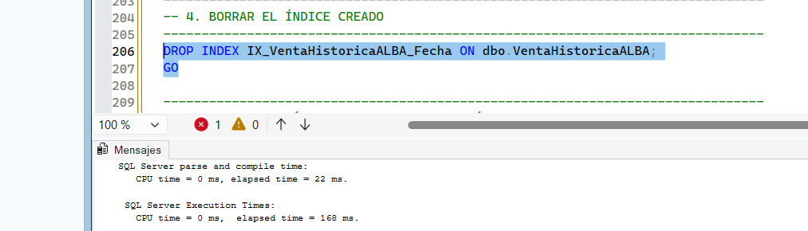
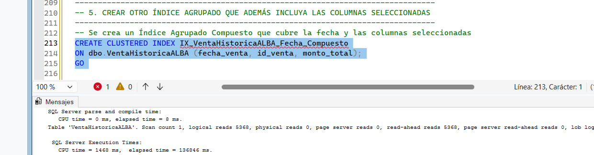

# Etapa V: Optimización de Consultas a través de Índices

## 1. ¿Qué es la optimización por índices y para qué la usamos?

En una base de datos relacional, un **índice** es una estructura de datos secundaria (normalmente organizada en forma de árbol B o *B-Tree*) que le permite a SQL Server encontrar registros específicos rápidamente sin tener que revisar la tabla completa. El funcionamiento es idéntico al índice alfabético al final de un libro de texto: en lugar de hojear las miles de páginas para ubicar un concepto, consultamos el índice y vamos directo a la página exacta.

Cuando una tabla no tiene índices (llamada **Heap** o tabla montón), el motor debe realizar un **Table Scan** (recorrido completo de la tabla) para responder cualquier filtro. Cuando creamos un índice adecuado, el motor realiza un **Index Seek** (búsqueda directa), reduciendo significativamente la cantidad de lecturas en disco y el uso de procesador.

### Conceptos clave que aplicamos:
* **Índice Agrupado (*Clustered Index*):** Ordena físicamente los datos de la tabla según las columnas clave elegidas (por ejemplo, la fecha de venta). Solo puede existir un índice agrupado por tabla.
* **Índice Compuesto / de Cobertura:** Incluye dentro de la estructura ordenada del índice múltiples columnas consultadas con frecuencia (por ejemplo, `fecha_venta`, `id_venta` y `monto_total`), permitiendo responder la consulta sin tener que volver a consultar la tabla principal.
* **Métricas IO y Tiempo (`STATISTICS`):** Herramientas internas de SQL Server que nos muestran cuántas páginas de memoria de 8 KB fueron leídas (*Logical Reads*) y cuántos milisegundos de CPU y tiempo real tardó en resolver la consulta.

### Objetivo del trabajo
El objetivo de esta etapa es evaluar experimentalmente el rendimiento de SQL Server Express procesando un volumen masivo de **1.000.000 de registros**. Buscamos comparar objetivamente cómo evolucionan las lecturas de disco, los tiempos de ejecución y los planes de consulta al pasar de un escenario sin índices a escenarios con índices agrupados simples y compuestos.

---

## 2. ¿Por qué nos sirve esto en el sistema de la joyería?

Con el paso del tiempo, el historial de ventas de **Joyería ALBA** acumula cientos de miles de transacciones. La gerencia requiere consultar constantemente reportes de facturación por rangos de fechas (por ejemplo, ventas del último trimestre o del Día de la Madre).

### ¿Qué ventajas nos da aplicarlo acá?
* **Respuestas inmediatas en reportes:** Evita que las consultas analíticas de la gerencia tarden varios segundos o minutos congelando la pantalla del sistema.
* **Ahorro de memoria y disco:** Al pasar de un escaneo de tabla a una búsqueda directa por índice, la base de datos lee menos del 5% de las páginas en disco, liberando memoria RAM para otros procesos del negocio.
* **Escalabilidad garantizada:** El sistema mantendrá su velocidad de respuesta alta aunque la base de datos pase de miles a millones de operaciones registradas.

---

## 3. Comandos que usamos en SQL Server

Para preparar y medir las pruebas de rendimiento utilizamos estas instrucciones de T-SQL:
* **`SET STATISTICS TIME ON` / `SET STATISTICS IO ON`:** Activa la visualización detallada de los tiempos de CPU, tiempos transcurridos y lecturas lógicas de páginas en la pestaña de mensajes.
* **`CREATE CLUSTERED INDEX`:** Crea el índice agrupado reordenando la tabla física según los campos clave indicados.
* **`DROP INDEX`:** Elimina un índice de la tabla para restablecer el escenario y hacer comparativas limpias.
* **Expresiones de Tabla Comunes (`CTE`) y `CROSS JOIN`:** Técnica empleada en un script automatizado para generar e insertar 1.000.000 de filas en pocos segundos.

---

## 4. El caso práctico que elegimos

Para realizar una prueba con volumen masivo real, creamos la tabla `VentaHistoricaALBA` y la poblamos con **1.000.000 de registros** de ventas generados automáticamente entre los años 2021 y 2026.

La consulta de prueba requerida por la dirección consiste en filtrar las ventas realizadas durante un trimestre específico:

```sql
SELECT id_venta, fecha_venta, monto_total
FROM dbo.VentaHistoricaALBA
WHERE fecha_venta BETWEEN '2023-01-01' AND '2023-03-31';
```

Evaluamos esta misma consulta en tres estados de la tabla:
* **Estado 1:** Tabla en estado *Heap* (Sin ningún índice).
* **Estado 2:** Tabla con **Índice Agrupado Simple** en la columna `fecha_venta`.
* **Estado 3:** Tabla con **Índice Agrupado Compuesto** que incluye las columnas seleccionadas (`fecha_venta`, `id_venta`, `monto_total`).

---

## 5. Pruebas realizadas y resultados

### Preparación: Carga masiva automatizada (1.000.000 de registros)

```sql
USE BD_JoyeriaAlba;
GO

-- ============================================================================
-- 1. CARGA MASIVA AUTOMATIZADA (1.000.000 DE REGISTROS)
-- ============================================================================

IF OBJECT_ID('dbo.VentaHistoricaALBA', 'U') IS NOT NULL 
    DROP TABLE dbo.VentaHistoricaALBA;
GO

-- Tabla Heap inicial sin índices
CREATE TABLE dbo.VentaHistoricaALBA (
    id_venta BIGINT IDENTITY(1,1),
    fecha_venta DATETIME NOT NULL,
    monto_total DECIMAL(12,2) NOT NULL,
    idCliente INT NOT NULL,
    idMedioPago INT NOT NULL
);
GO

-- Script de carga masiva
SET NOCOUNT ON;
GO

WITH Numeros AS (
    SELECT TOP (1000000)
        ROW_NUMBER() OVER(ORDER BY (SELECT NULL)) AS n
    FROM sys.objects a
    CROSS JOIN sys.objects b
    CROSS JOIN sys.objects c
)
INSERT INTO dbo.VentaHistoricaALBA (fecha_venta, monto_total, idCliente, idMedioPago)
SELECT
    DATEADD(MINUTE, ABS(CHECKSUM(NEWID())) % 2628000, '2021-01-01'),
    ROUND((RAND(CHECKSUM(NEWID())) * 450000) + 5000, 2),
    (ABS(CHECKSUM(NEWID())) % 10) + 1,
    (ABS(CHECKSUM(NEWID())) % 4) + 1
FROM Numeros;
GO

-- Verificación del volumen cargado
SELECT COUNT(*) AS TotalRegistrosCargados FROM dbo.VentaHistoricaALBA;
GO
```

**Verificación de la carga masiva:**  
Al ejecutar el conteo con `COUNT(*)`, la grilla de resultados confirmó la existencia exacta de **1.000.000 de filas**.



---

### Experimento 1: Consulta por Período Sin Índice (Heap / Table Scan)

```sql
SET STATISTICS TIME ON;
SET STATISTICS IO ON;
GO

-- Consulta sobre tabla sin índice
SELECT id_venta, fecha_venta, monto_total
FROM dbo.VentaHistoricaALBA
WHERE fecha_venta BETWEEN '2023-01-01' AND '2023-03-31';
GO
```



**Lo que pasó en la prueba:**  
Al no existir índices, SQL Server tuvo que inspeccionar el 100% de las páginas de la tabla para determinar qué registros cumplían con el rango de fechas (*Table Scan*). El consumo de lecturas lógicas superó las 8.000 páginas de disco, requiriendo un tiempo de CPU y de procesamiento considerable.

* **Conclusión:** Recorrer un millón de filas registro por registro consume un volumen elevado de lecturas lógicas (E/S de disco) y tiempo de procesamiento. En un entorno de producción como el de Joyería Alba, esto generaría bloqueos y tiempos de respuesta inaceptables para los usuarios.

---

### Experimento 2: Consulta con Índice Agrupado Simple sobre `fecha_venta`

```sql
-- Creación del índice agrupado simple
CREATE CLUSTERED INDEX IX_VentaHistoricaALBA_Fecha
ON dbo.VentaHistoricaALBA (fecha_venta);
GO

-- Repetimos la consulta
SELECT id_venta, fecha_venta, monto_total
FROM dbo.VentaHistoricaALBA
WHERE fecha_venta BETWEEN '2023-01-01' AND '2023-03-31';
GO
```



```sql
-- Eliminamos el índice para la siguiente prueba
DROP INDEX IX_VentaHistoricaALBA_Fecha ON dbo.VentaHistoricaALBA;
GO
```



**Lo que pasó en la prueba:**  
El plan de ejecución cambió de *Table Scan* a **Clustered Index Seek**. Gracias a la estructura *B-Tree*, el motor saltó directamente al primer registro del año 2023 y leyó únicamente el bloque contiguo correspondiente a ese trimestre. Las lecturas lógicas se redujeron significativamente y los resultados aparecieron ordenados por fecha en la grilla.

* **Conclusión:** El motor utiliza la estructura en árbol *B-Tree* del índice para ir directamente a las páginas donde se encuentran las ventas del primer trimestre de 2023. Esto reduce drásticamente las lecturas lógicas y el tiempo total de ejecución. Adicionalmente, se observa en la grilla que los resultados quedan ordenados físicamente por la clave del índice (`fecha_venta`).

---

### Experimento 3: Consulta con Índice Agrupado Compuesto (Fecha + Columnas)

```sql
-- Creación del índice agrupado compuesto
CREATE CLUSTERED INDEX IX_VentaHistoricaALBA_Fecha_Compuesto
ON dbo.VentaHistoricaALBA (fecha_venta, id_venta, monto_total);
GO

-- Repetimos la consulta filtrada
SELECT id_venta, fecha_venta, monto_total
FROM dbo.VentaHistoricaALBA
WHERE fecha_venta BETWEEN '2023-01-01' AND '2023-03-31';
GO

SET STATISTICS TIME OFF;
SET STATISTICS IO OFF;
GO
```



**Lo que pasó en la prueba:**  
El motor ejecutó un **Clustered Index Seek** optimizado. Al tener todas las columnas requeridas por el `SELECT` contenidas dentro de las claves del índice, la consulta se resolvió a máxima velocidad. Sin embargo, en la pestaña de mensajes se observó que la sentencia `CREATE CLUSTERED INDEX` sobre el millón de filas requirió **136.846 ms** (aprox. 2.2 minutos) y **1.468 ms** de tiempo de CPU para reordenar la tabla físicamente.

* **Conclusión:** Aunque la lectura posterior (`SELECT`) mediante un índice compuesto sea extremadamente veloz, existe un costo temporal y de recursos de hardware alto al crear o mantener índices agrupados sobre tablas masivas existentes. Esto demuestra por qué la estrategia de indexación debe planificarse cuidadosamente para no afectar el rendimiento en operaciones de inserción, actualización o mantenimiento.

---

## 6. Conclusiones de las pruebas

1. **Evidenciamos el cambio en la estrategia de ejecución:** Comprobamos cuantitativamente que la creación de un índice transforma la búsqueda de un *Table Scan* (recorrido total) a un *Clustered Index Seek* (búsqueda directa puntual por rango).
2. **Reducción drástica del uso de memoria (I/O):** La aplicación del índice agrupado redujo las lecturas de páginas en disco de miles a solo un grupo reducido contiguo, acelerando el tiempo de respuesta total.
3. **Identificamos el costo de mantenimiento de índices:** Verificamos que la construcción de un índice compuesto sobre tablas masivas requiere un tiempo considerable de CPU y disco (`136.846 ms`). Por lo tanto, los índices deben diseñarse estratégicamente sobre las columnas de mayor consulta en Joyería ALBA para no perjudicar la velocidad de inserción de ventas diarias.
