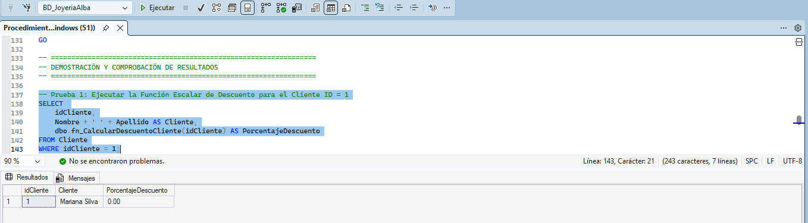
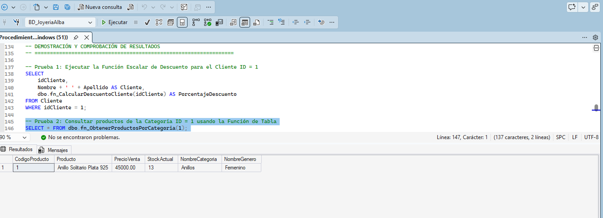
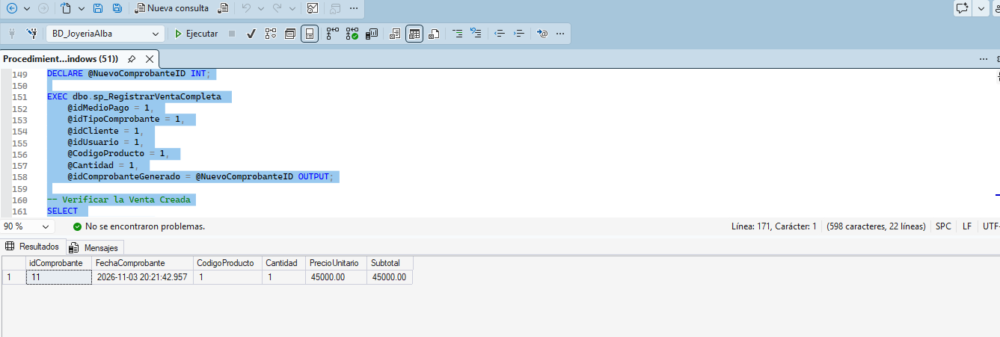

# Etapa V: Procedimientos y Funciones Almacenadas

## 1. ¿Qué son y para qué se utilizan?

### Procedimientos Almacenados (`STORED PROCEDURE`)
Son bloques estructurados de código T-SQL que se guardan y compilan directamente en el motor de la base de datos. Se utilizan principalmente para resolver la lógica operativa del negocio (operaciones como `INSERT`, `UPDATE` o `DELETE`), permitiendo realizar transacciones completas en un solo paso (por ejemplo, registrar una venta y descontar stock automáticamente).

### Funciones Definidas por el Usuario (`UDF`)
Son rutinas programables que reciben parámetros de entrada, realizan un cálculo o procesamiento interno y retornan obligatoriamente un resultado:
* **Funciones escalares:** devuelven un único dato concreto (`DECIMAL`, `INT`, etc.). Son ideales para cálculos repetitivos, como determinar un descuento o un recargo.
* **Funciones con valores de tabla:** devuelven un conjunto de filas con estructura de tabla. Sirven para encapsular consultas y utilizarlas de forma directa dentro de sentencias `SELECT`, uniones `JOIN` o cláusulas `WHERE`.

---

## 2. Ventajas de su aplicación en el sistema de la joyería

* **Rendimiento optimizado:** SQL Server compila el procedimiento o función la primera vez que se ejecuta y guarda el plan en memoria caché. Esto hace que las siguientes ejecuciones sean más rápidas, reduciendo el tráfico de red y el consumo de CPU.
* **Seguridad y abstracción:** Permite aislar el acceso directo a las tablas sensibles del local (`Comprobante`, `Producto`, `Compra`, `Usuario`). A los usuarios se les puede dar únicamente permiso de ejecución (`EXECUTE`) sobre las rutinas sin exponer la estructura de las tablas.
* **Mantenibilidad y reutilización:** Las reglas del negocio quedan centralizadas en la base de datos. Si el día de mañana cambia el porcentaje de descuento a clientes o la forma de restar stock, solo se ajusta la rutina en el servidor sin tener que reescribir la aplicación externa.

---

## 3. Implementación en SQL Server Express

* Se crean mediante las sentencias de DDL `CREATE PROCEDURE` (o `CREATE PROC`) y `CREATE FUNCTION`.
* Las funciones escalares se definen con `RETURNS <tipo_dato>` y utilizan un cuerpo delimitado por `BEGIN ... END`.
* Las funciones de tabla en línea usan `RETURNS TABLE` y retornan directamente el resultado de una consulta `SELECT`.
* Los procedimientos almacenados reciben parámetros de entrada y pueden incluir parámetros de salida (`OUTPUT`) para devolver identificadores generados (como el ID del nuevo comprobante) al proceso que los llamó.

---

## 4. Componentes implementados para Joyería Alba

Para dar respuesta a los requerimientos del local se diseñaron tres rutinas específicas:

* **Función Escalar (`dbo.fn_CalcularDescuentoCliente`):** Recibe el identificador del cliente (`idCliente`), suma el total histórico gastado en sus compras y determina un porcentaje de descuento por fidelidad (0%, 5% o 10%).
* **Función de Tabla (`dbo.fn_ObtenerProductosPorCategoria`):** Recibe el código de una categoría (`idCategoria`) y devuelve el listado completo de joyas y relojes disponibles en inventario de ese rubro, combinando sus categorías y géneros.
* **Procedimiento Almacenado (`dbo.sp_RegistrarVentaCompleta`):** Centraliza el circuito completo de una venta en el local:
  1. Valida la existencia del artículo y que cuente con stock suficiente.
  2. Invoca a la función de descuento para determinar el precio final.
  3. Inserta la cabecera en `Comprobante`.
  4. Inserta el renglón correspondiente en `DetalleComprobante`.
  5. Descuenta las piezas del campo `StockActual` en la tabla `Producto`.
  6. Devuelve mediante el parámetro `OUTPUT` el número de comprobante emitido.

---

## 5. Scripts de Demostración y Resultados Obtenidos

### Código DDL y Lógica de las Rutinas

```sql
USE BD_JoyeriaAlba;
GO

-- =================================================================
-- 1. FUNCIÓN ESCALAR: Calcular Descuento según Compras Acumuladas
-- =================================================================
IF OBJECT_ID('dbo.fn_CalcularDescuentoCliente', 'FN') IS NOT NULL
    DROP FUNCTION dbo.fn_CalcularDescuentoCliente;
GO

CREATE FUNCTION dbo.fn_CalcularDescuentoCliente
(
    @idCliente INT
)
RETURNS DECIMAL(5,2)
AS
BEGIN
    DECLARE @MontoAcumulado DECIMAL(10,2);
    DECLARE @PorcentajeDescuento DECIMAL(5,2);
    
    -- Sumar el total gastado por el cliente en todos sus comprobantes
    SELECT @MontoAcumulado = ISNULL(SUM(dc.Cantidad * dc.PrecioUnitario), 0.00)
    FROM Comprobante c
    INNER JOIN DetalleComprobante dc ON c.idComprobante = dc.idComprobante
    WHERE c.idCliente = @idCliente;
    
    -- Determinar el porcentaje de beneficio según volumen histórico
    IF @MontoAcumulado > 500000.00
        SET @PorcentajeDescuento = 0.10; -- 10%
    ELSE IF @MontoAcumulado > 200000.00
        SET @PorcentajeDescuento = 0.05; -- 5%
    ELSE
        SET @PorcentajeDescuento = 0.00; -- 0%
        
    RETURN @PorcentajeDescuento;
END;
GO

-- =================================================================
-- 2. FUNCIÓN DE TABLA: Obtener Joyas/Relojes por Categoría
-- =================================================================
IF OBJECT_ID('dbo.fn_ObtenerProductosPorCategoria', 'IF') IS NOT NULL
    DROP FUNCTION dbo.fn_ObtenerProductosPorCategoria;
GO

CREATE FUNCTION dbo.fn_ObtenerProductosPorCategoria
(
    @idCategoria INT
)
RETURNS TABLE
AS
RETURN
(
    SELECT 
        p.CodigoProducto,
        p.Nombre AS Producto,
        p.PrecioVenta,
        p.StockActual,
        c.NombreCategoria,
        g.NombreGenero
    FROM Producto p
    INNER JOIN Categoria c ON p.idCategoria = c.idCategoria
    INNER JOIN Genero g ON p.idGenero = g.idGenero
    WHERE p.idCategoria = @idCategoria 
      AND p.Estado = 'Disponible'
);
GO

-- =================================================================
-- 3. PROCEDIMIENTO ALMACENADO: Registrar Venta Completa
-- =================================================================
IF OBJECT_ID('dbo.sp_RegistrarVentaCompleta', 'P') IS NOT NULL
    DROP PROCEDURE dbo.sp_RegistrarVentaCompleta;
GO

CREATE PROCEDURE dbo.sp_RegistrarVentaCompleta
    @idMedioPago INT,
    @idTipoComprobante INT,
    @idCliente INT,
    @idUsuario INT,
    @CodigoProducto INT,
    @Cantidad INT,
    @idComprobanteGenerado INT OUTPUT
AS
BEGIN
    SET NOCOUNT ON;
    
    DECLARE @PrecioVenta DECIMAL(10,2);
    DECLARE @StockActual INT;
    DECLARE @Descuento DECIMAL(5,2);
    DECLARE @PrecioFinal DECIMAL(10,2);
    
    -- 1. Validar producto y verificar stock disponible
    SELECT @PrecioVenta = PrecioVenta, @StockActual = StockActual
    FROM Producto
    WHERE CodigoProducto = @CodigoProducto;
    
    IF @PrecioVenta IS NULL
    BEGIN
        RAISERROR('El producto especificado no existe.', 16, 1);
        RETURN;
    END
    
    IF @StockActual < @Cantidad
    BEGIN
        RAISERROR('Stock insuficiente en Joyería Alba para realizar la venta.', 16, 1);
        RETURN;
    END
    
    -- 2. Obtener descuento del cliente mediante la función escalar
    SET @Descuento = dbo.fn_CalcularDescuentoCliente(@idCliente);
    SET @PrecioFinal = @PrecioVenta * (1.00 - @Descuento);
    
    -- 3. Registrar encabezado de la venta (Comprobante)
    INSERT INTO Comprobante (FechaComprobante, idMedioPago, idTipoComprobante, idCliente, idUsuario)
    VALUES (GETDATE(), @idMedioPago, @idTipoComprobante, @idCliente, @idUsuario);
    
    SET @idComprobanteGenerado = SCOPE_IDENTITY();
    
    -- 4. Insertar detalle de venta con el precio unitario final
    INSERT INTO DetalleComprobante (idComprobante, Cantidad, PrecioUnitario, CodigoProducto)
    VALUES (@idComprobanteGenerado, @Cantidad, @PrecioFinal, @CodigoProducto);
    
    -- 5. Actualizar el inventario del producto vendido
    UPDATE Producto
    SET StockActual = StockActual - @Cantidad
    WHERE CodigoProducto = @CodigoProducto;
    
    PRINT 'Venta completada con éxito. ID Comprobante: ' + CAST(@idComprobanteGenerado AS VARCHAR(10));
END;
GO
```

---

### Demostración y Comprobación en SQL Server

#### Prueba 1: Evaluación de la Función Escalar de Descuento
Se evalúa la función para el cliente con identificador 1 (`Mariana Silva`), analizando su volumen de compra registrado en el sistema.

```sql
SELECT 
    idCliente,
    Nombre + ' ' + Apellido AS Cliente,
    dbo.fn_CalcularDescuentoCliente(idCliente) AS PorcentajeDescuento
FROM Cliente
WHERE idCliente = 1;
```

**Resultado obtenido:**  
La función se ejecuta correctamente y devuelve un porcentaje de descuento de `0.00` (0%), indicando que el cliente aún no alcanza el volumen de facturación necesario para aplicar los tramos de descuento de 5% o 10%.



---

#### Prueba 2: Consulta mediante la Función de Tabla
Se invoca la función pasando como parámetro el ID de categoría 1 (correspondiente a Anillos).

```sql
SELECT * FROM dbo.fn_ObtenerProductosPorCategoria(1);
```

**Resultado obtenido:**  
La función opera como una vista parametrizada, retornando la joya disponible para esa categoría (Anillo Solitario Plata 925), indicando su precio de venta ($45.000), existencia en stock (13 unidades) y los nombres resueltos de su categoría y género sin necesidad de escribir los `JOIN` en la consulta principal.



---

#### Prueba 3: Ejecución del Procedimiento Almacenado de Venta
Se realiza la llamada al procedimiento para registrar la venta de 1 unidad del producto 1 y se consulta el comprobante emitido a través de su parámetro de salida.

```sql
DECLARE @NuevoComprobanteID INT;

EXEC dbo.sp_RegistrarVentaCompleta 
    @idMedioPago = 1, 
    @idTipoComprobante = 1, 
    @idCliente = 1, 
    @idUsuario = 1, 
    @CodigoProducto = 1, 
    @Cantidad = 1, 
    @idComprobanteGenerado = @NuevoComprobanteID OUTPUT;

-- Verificación del comprobante recién generado
SELECT 
    c.idComprobante,
    c.FechaComprobante,
    dc.CodigoProducto,
    dc.Cantidad,
    dc.PrecioUnitario,
    (dc.Cantidad * dc.PrecioUnitario) AS Subtotal
FROM Comprobante c
INNER JOIN DetalleComprobante dc ON c.idComprobante = dc.idComprobante
WHERE c.idComprobante = @NuevoComprobanteID;
```

**Resultado obtenido:**  
El procedimiento valida el stock, aplica la lógica comercial y crea de forma atómica el comprobante número 11, enlazando su respectivo renglón de detalle con el importe correspondiente ($45.000) y actualizando el stock físico del anillo.



---

## 6. Conclusiones

* **Automatización y consistencia operativa (`dbo.sp_RegistrarVentaCompleta`):** La prueba confirmó que es posible encapsular en una sola llamada la validación de inventario, el cálculo de descuentos, el alta de la factura y la baja de existencias. Esto previene errores de stock y agiliza la comunicación entre la aplicación y el motor de base de datos.
* **Modularidad en reglas de negocio (`dbo.fn_CalcularDescuentoCliente`):** La función escalar permitió independizar la regla de beneficios por cliente de la lógica de facturación, facilitando que el porcentaje pueda ser consultado en cualquier listado o aplicado automáticamente durante la venta.
* **Simplificación en consultas de catálogo (`dbo.fn_ObtenerProductosPorCategoria`):** La función de tabla agiliza la visualización de piezas disponibles por rubro, evitando repetir combinaciones de tablas (`INNER JOIN`) en las consultas habituales del sistema de la joyería.
