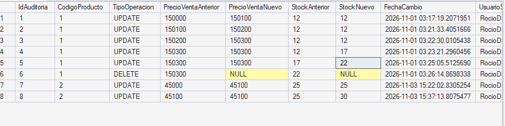
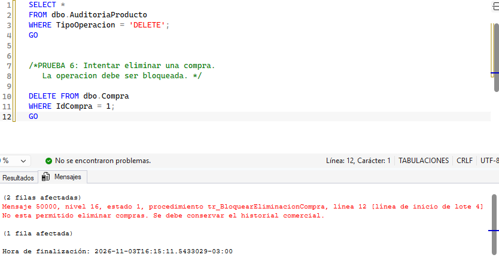

3. TRIGGERS DE AUDITORÍA

## ¿Qué son?

Los triggers (disparadores) son objetos de la base de datos que ejecutan automáticamente un conjunto de instrucciones SQL cuando ocurre un determinado evento sobre una tabla o vista.

En SQL Server, los triggers pueden activarse ante operaciones como "INSERT", "UPDATE" y "DELETE".

A diferencia de los procedimientos almacenados, que deben ser invocados explícitamente, los triggers se ejecutan automáticamente cuando se produce el evento para el cual fueron definidos.

## ¿Por qué utilizarlos?

Los triggers permiten automatizar controles y mantener la trazabilidad de las operaciones realizadas sobre la base de datos.

Entre sus principales ventajas se encuentran:

- Auditoría: permiten registrar quién realizó una modificación o eliminación y cuándo ocurrió.
- Trazabilidad: conservan información sobre los valores anteriores y posteriores a una modificación.
- Integridad: permiten controlar operaciones que podrían afectar información importante.
- Automatización: ejecutan acciones sin necesidad de que el usuario las invoque directamente.
- Control de operaciones: permiten impedir determinadas acciones no autorizadas o no permitidas por las reglas del sistema.

## Funcionamiento en SQL Server

SQL Server proporciona dos tablas lógicas especiales para trabajar con triggers:

- inserted: contiene los nuevos valores generados por una operación "INSERT" o los valores posteriores a una modificación "UPDATE".
- deleted: contiene los valores eliminados por una operación "DELETE" o los valores anteriores a una modificación "UPDATE".

Estas tablas permiten acceder a los datos involucrados en una operación y comparar los valores anteriores y posteriores.

Un trigger también puede responder a más de un evento. Por ejemplo, puede definirse para ejecutarse ante operaciones "UPDATE" y "DELETE", diferenciando cada caso mediante las tablas "inserted" y "deleted".

Caso de aplicación: Sistema de gestión comercial de joyería

## Problema de negocio

En el sistema de gestión comercial de la joyería, los productos poseen información importante, como su precio de venta y el stock disponible. Una modificación o eliminación de estos datos podría afectar el control del inventario y la información comercial.

Por este motivo, se implementan mecanismos de auditoría sobre la tabla Producto, que permiten conservar un historial de las modificaciones y eliminaciones realizadas.

Además, se incorpora un mecanismo de protección sobre la tabla Compra para impedir que se eliminen registros que deben conservarse como parte del historial de operaciones comerciales.

## Implementación en SQL Server Express

1. Creación de la tabla de auditoría

- Se crea una tabla auxiliar denominada AuditoriaProducto, destinada a almacenar los movimientos realizados sobre los productos.

- La información registrada incluye:

- Identificador del registro de auditoría.

-  Código del producto afectado.

- Tipo de operación realizada (UPDATE o DELETE).

- Precio de venta anterior y nuevo.

- Stock anterior y nuevo.

- Fecha y hora del evento.

- Usuario de SQL Server que ejecutó la operación.

Esta tabla permite conservar información histórica incluso cuando un producto es eliminado de la tabla principal.

2. Trigger de auditoría de productos

Se implementa un trigger sobre la tabla Producto que se ejecuta automáticamente ante operaciones UPDATE y DELETE.

## Cuando se realiza un UPDATE:

El trigger utiliza las tablas deleted e inserted para recuperar los valores anteriores y nuevos del producto. Luego, registra los cambios en AuditoriaProducto.

De esta manera, si se modifica el precio de venta o el stock, queda almacenado el estado anterior y el estado posterior a la operación.

## Cuando se realiza un DELETE:

El trigger utiliza la tabla deleted para recuperar la información del producto antes de su eliminación y almacenarla en la tabla de auditoría.

Como el producto deja de existir en la tabla principal, los campos correspondientes a los valores nuevos se registran como NULL.

3. Trigger de bloqueo de eliminación de compras

También se implementa un trigger sobre la tabla Compra para impedir la eliminación de registros.

Su objetivo es proteger el historial de compras realizadas a proveedores, evitando que se pierda información importante para el control comercial.

Cuando se intenta eliminar una compra, el trigger emite un mensaje indicando que la operación no está permitida y cancela la eliminación.

## Demostración y pruebas

Para comprobar el funcionamiento de los triggers se realizaron distintas operaciones sobre la base de datos BD_Joyeria_Practica.

## Prueba 1: Modificación del precio de venta

Se ejecuta una actualización sobre el producto con código 2, incrementando su precio de venta en $100.

UPDATE dbo.Producto
SET PrecioVenta = PrecioVenta + 100
WHERE CodigoProducto = 2;
GO

Resultado esperado:

La modificación se realiza correctamente y el trigger registra automáticamente el precio anterior y el nuevo en la tabla AuditoriaProducto.

Evidencia:

La ejecución muestra que se modificó una fila correctamente.

Prueba 2: Modificación del stock

Se ejecuta una actualización sobre el stock del producto con código 2, incrementando su cantidad en 5 unidades.

UPDATE dbo.Producto
SET StockActual = StockActual + 5
WHERE CodigoProducto = 2;
GO

Resultado esperado:

La actualización se realiza correctamente y el trigger registra el stock anterior y el nuevo en la tabla de auditoría.

Evidencia:

La ejecución se completa sin errores, demostrando que la modificación fue realizada correctamente.

Prueba 3: Auditoría de modificaciones y eliminación de productos

Una vez realizadas las operaciones de actualización y eliminación, se consulta la tabla de auditoría para verificar los registros generados automáticamente.

SELECT *
FROM dbo.AuditoriaProducto
ORDER BY IdAuditoria DESC;
GO

Resultado obtenido:

Se observa que la tabla registra diferentes operaciones realizadas sobre los productos, incluyendo modificaciones de precios, modificaciones de stock y eliminaciones.

En cada registro se conservan los valores anteriores y nuevos, el tipo de operación, la fecha del cambio y el usuario responsable.

En el caso de las eliminaciones, los valores nuevos aparecen como NULL, ya que el producto fue eliminado de la tabla principal.

Evidencia:

La consulta permite comprobar que las operaciones quedaron registradas correctamente en la tabla auxiliar AuditoriaProducto.

Prueba 4: Intento de eliminación de una compra

Se intenta eliminar una compra existente de la tabla Compra, utilizando el identificador 1.

DELETE FROM dbo.Compra
WHERE IdCompra = 1;
GO

Resultado esperado:

El trigger detecta el intento de eliminación, emite un mensaje de advertencia y cancela la operación.

Resultado obtenido:

SQL Server muestra el mensaje indicando que la eliminación de compras no está permitida y que se debe conservar el historial comercial.

Por lo tanto, el registro permanece protegido y no se permite su eliminación.

Evidencia:

La ejecución demuestra que el trigger de protección interviene automáticamente ante el intento de eliminar un registro.

Resultados obtenidos

A partir de las pruebas realizadas se obtuvieron los siguientes resultados:

| Operación | Resultado |
|---|---|
| Actualización del precio de un producto | Correcta. Se registra el cambio. |
| Actualización del stock de un producto | Correcta. Se registra el cambio. |
| Eliminación de un producto | Se conserva el registro de auditoría. |
| Eliminación de una compra | Operación bloqueada por el trigger. |

Las pruebas permiten verificar que los triggers funcionan de manera automática y que la información de auditoría se conserva en la tabla auxiliar.

## Conclusión

La implementación de triggers de auditoría permite mejorar la trazabilidad y el control de los datos del sistema de gestión comercial de la joyería.

Mediante el registro automático de las modificaciones y eliminaciones, es posible conservar información histórica sobre los productos y conocer cuándo y por quién fueron realizadas las operaciones.

Por otra parte, el trigger aplicado sobre la tabla Compra permite proteger el historial de operaciones comerciales, evitando eliminaciones que podrían ocasionar la pérdida de información importante.

De esta manera, los triggers contribuyen a mejorar la integridad, seguridad y confiabilidad de la base de datos.